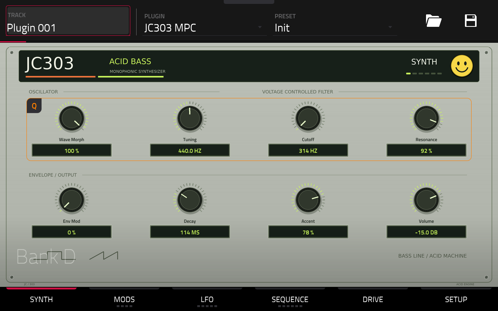
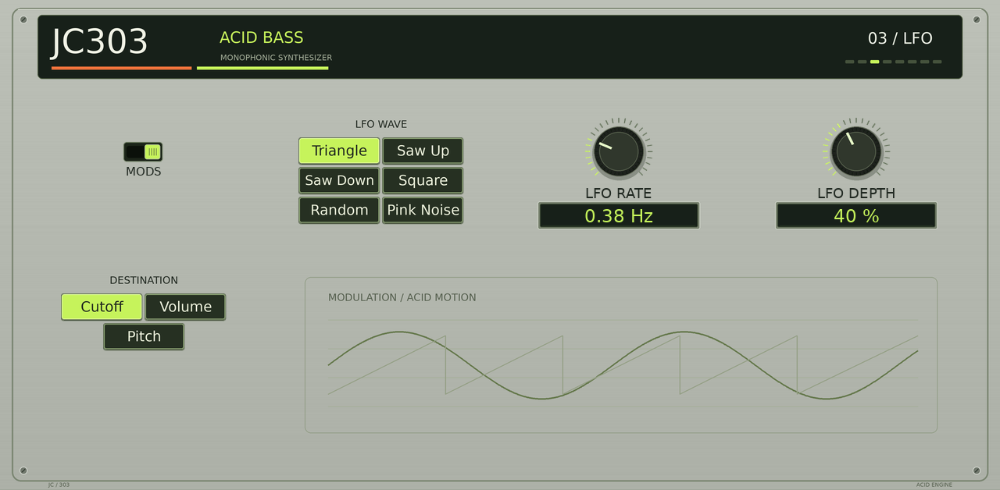

> **100% AI-generated MPC port and design — tested by the maintainer on a real MPC Live III.**
>
> The MPC-specific integration, interface, artwork tooling, optimizations and documentation were developed with Codex. The original JC303, Open303, Aciduino, GuitarML models and bundled libraries are existing upstream work by their respective authors; the AI statement does not claim authorship of those components.

# JC303 MPC

An Acid / TB-303-style instrument for **Gen2 MPCs (ARM64)**, based on [midilab/jc303](https://github.com/midilab/jc303). It runs as a native ARM64 VST2 plugin on **MPC OS 3.10.1 or newer**, with a touchscreen interface, Q-Links, MPC presets and project save/restore.

The project and installed instrument are named **JC303 MPC**. The catalog display name is **JC303**. The repository URL and existing plugin identifier remain unchanged, so projects made with this port keep recognizing it. It is a separate plugin from other Open303 ports.

These are **offline renders of the actual built skin with values queried from the compiled plugin**, not photographs or captures of the MPC display. Host fonts are approximated using DejaVu. The maintainer confirmed the 0.2.2 controls, Q-Link frames, step selection and Sounds tile on a real MPC Live III with MPC OS 3.10.1. The maintainer also confirmed Candidate 5 of 0.2.3 on that device and authorized its release.

## Features

- Open303-based mono voice with waveform morph, tuning, cutoff, resonance, envelope modulation, decay, accent and output level.
- TeeBee, Diode Octave and Diode filters, plus the JC303 modifications and LFO.
- Extended Slide Time up to **1 second**, with migration of older saved slide durations.
- **16-step sequencer** synchronized to MPC tempo/transport: adjustable length, notes, rests, accents, slides, ties and transpose.
- Pattern generator with fill, accent/slide/tie probabilities, pitch-class count and note-range controls.
- MIDI/pad step recording: velocity 100+ records accent; overlapping notes record slide; sustain-pedal down enters a rest.
- **37 embedded GuitarML drive models**, with level/gain, equal-power dry/wet mixing, background model preparation and fades during model changes.
- **12 factory programs** in the native MPC preset browser, including dry **Init** and two sequenced patches. New instances start with Drive and Sequencer off.
- Six native pages: **SYNTH, MODS, LFO, SEQUENCE, GENERATE, DRIVE**, with Q-Link mappings and complete sound/pattern/drive project state.
- Custom 303-style panels, rotary knobs, switches and Acid smiley. Step selection uses a bright border that leaves its caption visible.
- A **Sounds → Plugin** browser tile and a loadable **Init `.xpl`** preset.
- OpenMPC Installer-compatible packaging with installation scripts, manifests and checksums.

## Screenshots

| MODS | LFO |
|---|---|
|  |  |

| GENERATE | DRIVE |
|---|---|
|  |  |

Native Sounds-browser artwork:

## Installation and use

Target: **Gen2 MPCs, aarch64, MPC OS 3.10.1+**. Hardware testing has been performed on **MPC Live III only**; other Gen2 models have not been individually tested. Gen1 ARM32 devices and desktop plugin formats are outside this port’s current support scope.

Build an installation ZIP as described in [BUILDING.md](BUILDING.md), then import the release ZIP into the [OpenMPC Installer](https://github.com/open-mpc/mpc-vst-plugins). Keep the ZIP intact. The installer package includes the plugin, skin, browser artwork, Init preset, licenses, installation scripts and checksums. Download the [0.2.3 Gen2 release](https://github.com/303inmyheart/OpenMPC-JC303/releases/tag/jc303-mpc-v0.2.3). This exact installer was confirmed by the maintainer on Live III / OS 3.10.1. See [STORE.md](STORE.md) for catalog status.

Enable **Preferences → Enhancements → External Plugin Support** and select **JC303 MPC** under External VST Plugins.

Play from pads, keys or MIDI clips. Overlapping notes slide and velocities of 100 or more accent. Enable **MODS** to engage the extra circuit/LFO settings. Filter Drive affects the diode filter's input saturator; its display indicates when MODS is off or a non-diode filter is selected.

On **SEQUENCE**, enable SEQUENCER and press MPC Play. Tap a step or use EDIT STEP, then edit NOTE, REST, ACCENT, SLIDE and TIE. The SEQUENCER switch is beside TIE. On **GENERATE**, set probabilities/range and generate a pattern, or enable RECORD for step input. GENERATE and CLEAR replace pattern data and currently have no undo.

On **DRIVE**, enable the effect and choose a model. LEVEL / GAIN controls the second input of conditioned models or the input gain of fixed models, following JC303's original mapping. Models are embedded; no model files or downloads are needed at runtime. Bypass returns to dry audio.

## Performance and validation

Native ASan/UBSan/leak tests and ARM64 shared-object tests under QEMU pass. Isolated ARM64 host/voice tests also passed on the real Live III. These are separate from the maintainer's hands-on tests of the installed instrument.

The 0.2.1 optimization reduced measured audio-thread CPU for **Blackstar HT40 GainKnob SM57mic + sequencer from 17.76% to 6.78% of one fast CPU core**. The stopped case went from 16.44% to 5.45%. TS9 and RAT showed similar improvements. Captured Blackstar audio was bit-identical before/after. These isolated benchmark percentages are **not the MPC's overall CPU meter**.

Details, limits and reproducible measurement data: [PERFORMANCE.md](PERFORMANCE.md), [TESTING.md](TESTING.md), [benchmarks](benchmarks/live-iii-0.2.1.json). Multiple wet instances, parameter-sweep spikes and extended project stability still need broader testing.

The official 0.2.3 benchmark on MPC Live III / OS 3.10.1 reports **WARN**: p99 **16.5%**, worst block **24.6%** of one fast core during the random Q-Link stress stage. WARN is permitted with a note; it is not a FAIL. Full result: [benchmarks/0.2.3/bench.txt](benchmarks/0.2.3/bench.txt).

## Roadmap

Implemented through **0.2.3**: synth/mods/LFO, host-synchronized sequencer and recording/generator, 37 drive models, native preset bank, Acid interface, CPU optimization, complete Q-Link frames, border-only step selection and Sounds-browser artwork.

Next validation:

- The [catalog entry was accepted](https://github.com/open-mpc/mpc-vst-plugins/pull/845); future releases are discovered by the catalog build.
- Broaden multi-instance, parameter-sweep and long-session testing.
- Measure multiple instances and parameter-change spikes; run longer stability sessions.

The following original-desktop features are **deferred for now**:

- Desktop JC303 preset import and custom drive-model import.
- Sequencer MIDI output to other instruments.
- Internal clock, direct MIDI-clock synchronization and note-trigger start. Currently the sequencer follows MPC transport.
- The desktop on-screen keyboard is replaced by MPC pads and the NOTE control.

Other planned ports, in order: **Geonkick MPC → Fire MPC → Wolf Shaper MPC → BYOD MPC feasibility review → Surge MPC**. BYOD first requires an assessment of whether effect-chain navigation/editing works well on MPC. Full project queue and status: [ROADMAP.md](ROADMAP.md).

### Drive-model naming

The 0.2.3 skin uses neutral model names to comply with the catalog’s branding policy. For example, **Valve Combo / Dynamic Mic** is the original Blackstar HT40 SM57 capture. All 37 original names and stable file identities are credited in [MODELS.md](MODELS.md). Model order, weights and saved sound identities are unchanged.

## Source and build

The default **`mpc-live-iii`** branch contains this port. The fork's **`main`** branch preserves the original JC303 source. This port is based on upstream commit `25d0ed1dab6d0edffc0e28c7d68c170a8af71aee`.

The MPC adapter uses the [OpenMPC toolchain](https://github.com/open-mpc/mpc-vst-plugins), pinned to `ef05a26c6e59f1bfd3ef2023e6a9d8b371b61310` with the included [float/host integration patch](patches/mpc-float32.patch). DSP/model dependencies are vendored. A C++20 compiler, ARM64 cross compiler, Python and Pillow are required. See [BUILDING.md](BUILDING.md) for checkout, build, tests and packaging.

## License and credits

The complete MPC port is **GPL-3.0-only**. See [LICENSE](LICENSE) for the full license text. Source and modifications must be distributed in accordance with the applicable licenses; the AI-generated development process does not replace upstream licensing or credits.

| Component | License / notice |
|---|---|
| JC303 and MPC adaptation | [GPL-3.0](LICENSE); original [JC303 by midilab and contributors](https://github.com/midilab/jc303) |
| Open303 engine | [MIT](src/dsp/open303/LICENSE), Robin Schmidt and contributors |
| Aciduino sequencer/harmonizer | [MIT](src/sequencer/LICENSE), Romulo Silva and contributors |
| OpenMPC wrapper/toolchain | [MIT](https://github.com/open-mpc/mpc-vst-plugins/blob/main/LICENSE) |
| RTNeural | [BSD-3-Clause](vendor/RTNeural/LICENSE) |
| xsimd | [BSD-3-Clause](vendor/xsimd/LICENSE) |
| math_approx | [BSD-3-Clause](vendor/math_approx/LICENSE) |
| nlohmann JSON | MIT, [bundled header notice](vendor/RTNeural/modules/json/json.hpp) |
| ChowDSP-derived RNN integration | GPL-3.0; [notice](src/drive/CHOWDSP-LICENSE.md) |
| DejaVu artwork font | [DejaVu/Bitstream notice](art/FONT-LICENSE.txt) |

The 37 model files are taken from the pinned JC303 distribution. Original identities, names, credits and dependency notices are retained. Exact provenance and local DSP/library changes are recorded in [src/VENDORED.md](src/VENDORED.md).
