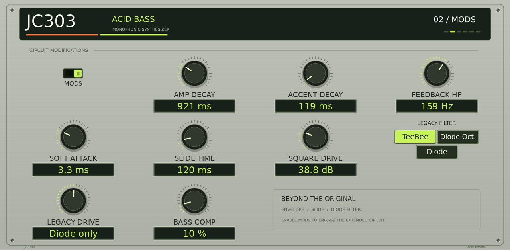
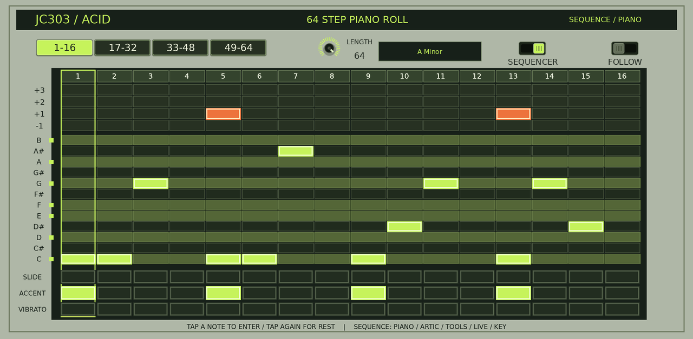
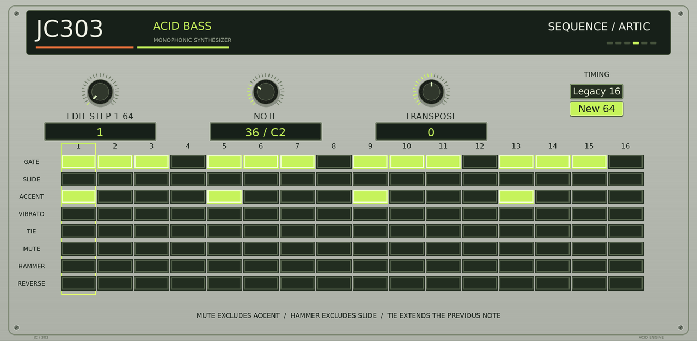
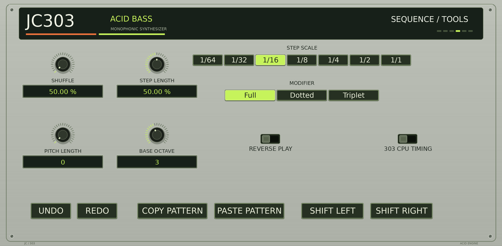
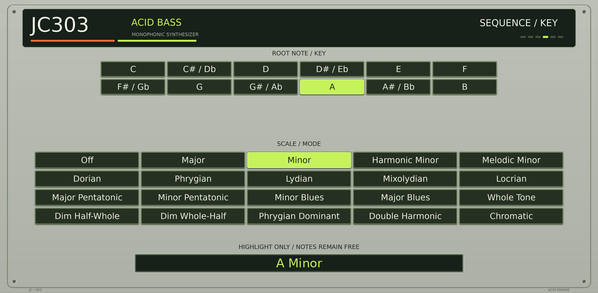
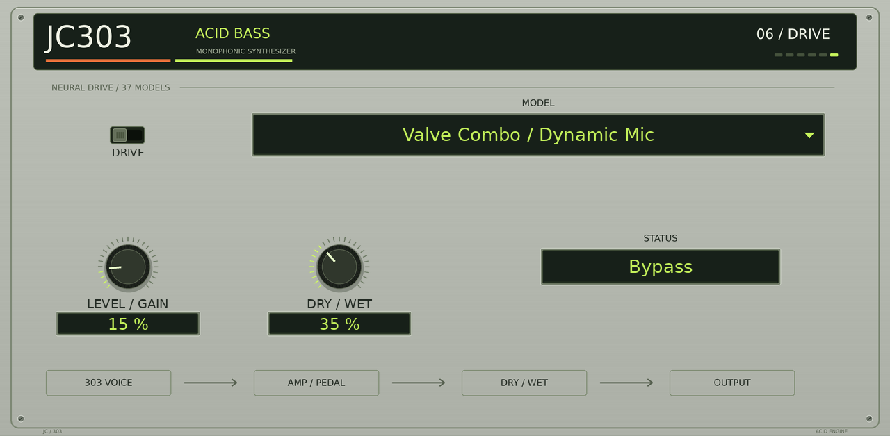

> **100% AI-generated MPC port and design — tested by the maintainer on a real MPC Live III.**
>
> The MPC integration, interface, artwork tooling, optimizations and documentation were developed with Codex. JC303, Open303, Aciduino, GuitarML models and bundled libraries are existing upstream work by their respective authors; this statement does not claim authorship of them.

# JC303 MPC

An Acid / TB-303-style instrument for **Gen2 MPCs (aarch64), MPC OS 3.10.1+**, based on [midilab/jc303](https://github.com/midilab/jc303). Hardware tests have been performed on **MPC Live III only**.

> **Release status: the public download is still 0.2.3.**
> **The new synthesis, 64-step sequencer, key/scale guide and updated screenshots below are a preview for the NEXT release. They are not included in the current 0.2.3 download.**
> Development build **0.4.2** is installed and being tested by the maintainer. The modulation matrix is in progress. There is no public release date or new binary release yet.

The project/installed name is **JC303 MPC**, the catalog display name is **JC303**. The repository URL and plugin identity remain unchanged.

## Available now: release 0.2.3

[Download the published 0.2.3 installer](https://github.com/303inmyheart/OpenMPC-JC303/releases/tag/jc303-mpc-v0.2.3).

This release contains:

- Open303 mono voice, original filter models, circuit modifications and LFO.
- 16-step sequencer synchronized to MPC transport/tempo, with note/rest, accent, slide, tie, generation and MIDI step recording.
- 37 embedded GuitarML amp/pedal models with gain, dry/wet and background preparation.
- Native MPC preset browser with 12 programs and a dry Init preset.
- Acid artwork, custom knobs, Q-Link mappings and a Sounds-browser tile.
- MPC project/preset state and an OpenMPC Installer-compatible ZIP.

The maintainer confirmed this release on Live III / MPC OS 3.10.1. Gen1/ARM32 and desktop plugin formats are outside this port's support scope.

## Next release preview — not in 0.2.3

The following changes are implemented in local development builds through **0.4.2** and are planned for the next public release:

- **JC303 v0.14 synthesis:** eight filters, TB-303 / Alpha Juno / Phaseshaper oscillators, Circuit square, sub oscillator and filter-shaping controls. ENGINE and FILTER are subpages of MODS.
- **64-step piano roll:** four 16-step pages, touch note/octave entry, a selected-step frame and moving playhead line.
- **Step articulation:** gate, slide, accent, vibrato, tie, mute, hammer and reverse.
- **Timing/editing:** shuffle, fractional gate length, Full/Dotted/Triplet step scale, reverse playback, pitch polymeter, clipboard and undo/redo.
- **Generate length 1–64:** only the active length is regenerated; later stored steps are retained.
- **Key/scale guide:** all 12 roots and 19 scales plus Off. It highlights note rows without changing notes, quantizing input or restricting the generator.
- **Touch feedback:** updates while stopped and playing; persistent switches use the same native recipe as MODS, independently of momentary note/octave triggers.
- **Compatibility:** the original synthesis/timing remain available for old projects. JC7 stores the 64-step pattern and key/scale guide. Older plugin versions cannot read JC7.

The maintainer confirmed the corrected pitch and ARTIC/front-lane touch controls in 0.4.2. Native sanitizer, actual ARM64/QEMU and skin/installer checks are separate from real-device acceptance. Extended stability and release validation remain.

**Currently being implemented for the next release:** the v0.14 modulation matrix. It has four slots: LFO, envelope and two selectable-source slots. It is not yet a working installed feature. Remaining LFO controls, Accent Sweep/global Reverse Gate, Pre-VCA/Disperse and original JSON preset banks remain on the [roadmap](ROADMAP.md).

Microtuning and additional external MIDI/macro controls are no longer planned. Existing MIDI note input, pad playing, recording and Q-Links remain.

## Screenshots — next release preview

**Every plugin-interface image in this section shows the unreleased development skin. These changes become available with the NEXT public release, not with the current 0.2.3 download.**

These are offline renders of the actual native skin using values queried from the compiled development plugin. They are not MPC screen captures; host fonts are approximated with DejaVu. No D16 code, artwork or reference image is distributed.

| Next release: MODS | Next release: LFO |
|---|---|
|  |  |

| Next release: ENGINE | Next release: FILTER |
|---|---|
|  |  |

| Next release: ARTIC | Next release: SEQTOOLS |
|---|---|
|  |  |

| Next release: SEQLIVE | Next release: SEQKEY |
|---|---|
|  |  |

| Next release: GENERATE | Next release: DRIVE |
|---|---|
|  |  |

There is no matrix screenshot yet: the matrix is still being implemented.

## Installation and use

Download the [published release ZIP](https://github.com/303inmyheart/OpenMPC-JC303/releases/tag/jc303-mpc-v0.2.3), keep it intact and import it into the [OpenMPC Installer](https://github.com/open-mpc/mpc-vst-plugins). It includes the plugin, skin, Init preset, licenses, scripts and checksums. The repository's preview screenshots do not change the contents of that release ZIP.

Enable **Preferences → Enhancements → External Plugin Support** and choose **JC303 MPC** under External VST Plugins. Play from pads, keys or MIDI clips. Overlapping notes slide; velocities of 100+ accent. MODS enables the extended circuit/LFO settings. DRIVE provides the embedded amp/pedal models.

Published-source build instructions are in [BUILDING.md](BUILDING.md). Instructions for testing the upcoming sequencer are in [the German development test guide](TESTPLAN-0.4.0-DE.md). Matching updated source and build instructions will accompany the next public binary release.

## Validation and performance

The published 0.2.3 Store benchmark is **WARN** (p99 16.5%, maximum 24.6%); see [PERFORMANCE.md](PERFORMANCE.md). This historical result does not describe 0.4.2 or the upcoming matrix.

Development builds are checked with native ASan/UBSan/leak tests, actual ARM64 shared-object tests under QEMU, state/timing/scale oracles and skin/installer validation. QEMU checks are not hardware benchmarks. The formal benchmark for the next release is reserved for its completed release build.

## Roadmap and license

See [ROADMAP.md](ROADMAP.md) for published, working-but-unreleased, in-progress and deferred work, including the other planned MPC ports.

Release **0.2.3** is **GPL-3.0-only**. The upcoming v0.14-based release combines **GPL-3.0-only AND AGPL-3.0-or-later**, with file-specific MIT/BSD notices retained. The [development license audit](LICENSE-AUDIT.md) describes that upcoming source; the matching notices and corresponding source must accompany the next binary release. Original authors retain their respective copyrights.
