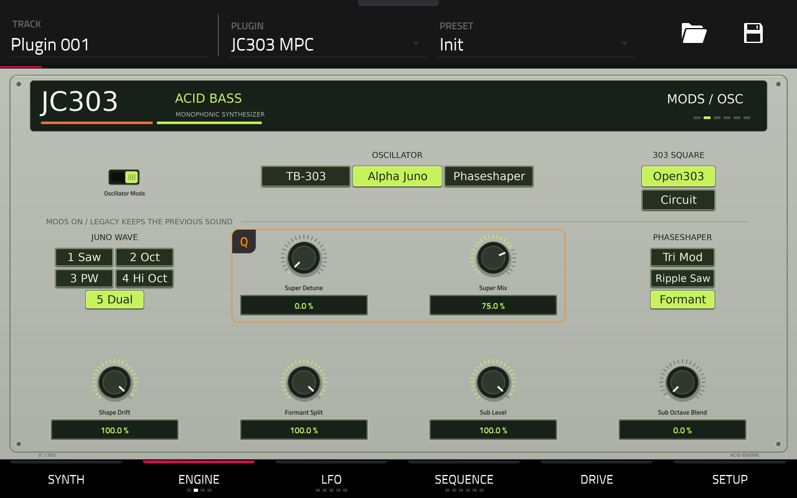

> **100% AI-generated MPC port and design — tested by the maintainer on a real MPC Live III.**
>
> The MPC integration, interface, artwork tooling, optimizations and documentation were developed with Codex. JC303, Open303, Aciduino, GuitarML models and bundled libraries are existing upstream work by their respective authors; this statement does not claim authorship of them.

# JC303 MPC

An Acid / 303-style instrument for **Gen2 MPCs (aarch64), MPC OS 3.10.1+**, based on [midilab/jc303 v0.14.0](https://github.com/midilab/jc303). Hardware testing has been performed on **MPC Live III only**.

**[Download JC303 MPC 1.0.0](https://github.com/303inmyheart/OpenMPC-JC303/releases/tag/jc303-mpc-v1.0.0)** — import the intact `JC303-MPC-1.0.0-mpc-aarch64.zip` into OpenMPC Installer.

The project and installed instrument are **JC303 MPC**; the OpenMPC catalog name is **JC303**. The repository URL and plugin UID stay fixed. Version 1.0.0 changes the manufacturer and installed folder; read the tutorial below before updating.

**1.0.0 adds all 18 original v0.14 factory sounds: 30 native MPC programs in total.** The manufacturer is now **303inmyheart**. Read the preset-migration notice below before updating.

> **Before updating to 1.0.0: preset compatibility changes.** The manufacturer changes from **midilab** to **303inmyheart**. Older personal MPC presets may be rejected until a compatible copy is made. **The installer does not convert user presets automatically.** Keep originals. [Migration instructions](PRESET-MIGRATION.md) · [Changelog](CHANGELOG.md).

## Preset tutorial — read before updating

**[Step-by-step tutorial: load your older presets](PRESET-MIGRATION.md)**

Start with the easy MPC-only route if your sound still plays in an old project:
save it as a new preset under a new name. The tutorial also explains how to
convert a copy of an old `.xpl` on a computer, while keeping the original and
sound data unchanged. **PRESET INFO** in the plugin opens the English guide.
The tutorial and [changelog](CHANGELOG.md) are included in the installer ZIP.

## Convert older presets

**[Python converter and step-by-step instructions](docs/PRESET-CONVERTER.md)** —
works for both JC303 MPC and Geonkick MPC. It previews changes and creates new
copies; originals and encoded sound data stay unchanged. Run it on your computer,
then copy the results to the MPC. The plugin installer does not run it for you.

## Features

- **v0.14 synthesis:** eight filter models; TB-303, Alpha Juno and Phaseshaper oscillators; Circuit square, sub oscillator and filter shaping. The legacy engine remains available for older projects.
- **64-step sequencer:** four 16-step piano-roll pages with touch note/octave entry, selected-step frame and moving playhead. Gate, slide, accent, vibrato, tie, mute, hammer and reverse lanes.
- **Pattern editing:** shuffle, fractional gates, Full/Dotted/Triplet step scaling, reverse playback, pitch polymeter, rotation, clipboard and undo/redo. Generate honors an adjustable length of 1–64 steps.
- **Key/scale guide:** all 12 roots and 19 scales plus Off. Highlights note rows without changing the pattern or restricting note input.
- **Three start modes:** Host Transport, Note Gate/Hold and latched Note Trigger. Note modes follow MPC tempo without transposing the stored pattern; the hardware Stop path clears latched playback. A separate touch/automatable STOP is available.
- **Four-slot modulation matrix:** fixed LFO and bipolar-envelope slots plus two selectable-source slots; eight source choices and fourteen destinations. LFO start phase, key sync and contour; Accent Sweep and global Reverse Gate.
- **Independent MODS bypasses:** global master plus Circuit, Oscillator, Filter and four matrix/LFO-slot switches. New instances and **Init start with all eight switches Off**; saved settings and existing factory sounds retain their routing. Enable **MODS MASTER in SETUP**, then enable the desired page or slot.
- **37 embedded neural drive models:** level, dry/wet, Pre/Post-VCA routing and eight-stage Disperse. Pre-VCA uses the modern engine; the legacy engine explicitly falls back to Post.
- **Native MPC interface:** six main menu keys, Acid artwork, custom knobs, native preset browser with thirty programs and dry Init, and a Sounds-browser tile. Q-Links follow visible knobs; Drive Model is the sole selector exception. Switches and other selectors use touch. Existing MIDI CC mappings are preserved.
- **CPU optimizations:** coalesced waveshaper requests and sequencer feedback, immutable parameter lookup and avoided inactive-filter coefficient work. No reduction in synthesis quality, oversampling or neural-model size.

## Real MPC screenshots

Captured by the maintainer on MPC Live III. These show edited test sounds, not necessarily Init defaults. SETUP is from 0.7.4; the other captures show the same 0.7 interface before the final MODS-Off defaults and printed SETUP reminder were added. No interface has been painted into the hardware captures.

| Oscillator models | Eight filter models |
|---|---|
|  |  |

| Drive and routing | Modulation matrix |
|---|---|
|  |  |

[Full hardware screenshot gallery, including SETUP and all sequencer pages](docs/GALLERY.md).

## Install or update

1. Save your project and keep a backup of projects/presets before upgrading.
2. Download the intact [1.0.0 release ZIP](https://github.com/303inmyheart/OpenMPC-JC303/releases/tag/jc303-mpc-v1.0.0) and import it into [OpenMPC Installer](https://github.com/open-mpc/mpc-vst-plugins). Install it as an update of JC303. A separate plugin entry or uninstall is unnecessary.
3. Restart the MPC application so it loads the new library. With **Preferences → Enhancements → External Plugin Support** enabled, select **JC303 MPC**.

The installer replaces the plugin's files at the existing identity. Older project states are migrated, including their enabled MODS settings. **Older plugin versions cannot read the new JC10 project state**: keep an original project copy if you need to return to 0.2.3. The ZIP includes scripts, manifests, checksums, native skin, Sounds artwork, Init and license notices. No ROMs, model downloads or runtime network connection are required.

## Validation and performance

Exact 1.0.0 ARM64 binary, measured on the real Live III / OS 3.10.1, 44.1 kHz / 128 frames, one A76 core:

| Benchmark | p99 block budget | Maximum | Verdict |
|---|---:|---:|---|
| Standard OpenMPC run | 34.4% | 37.5% | **WARN** |
| Additional full 348-parameter stress | 33.9% | 38.2% | **WARN** |

These are audio-thread times against one core's block budget, not the MPC project CPU meter. The installer records the standard run. The complete [0.7.4 report](benchmarks/1.0.0/README.md) and [optimization history](benchmarks/0.7.3/README.md) retain the original 0.7.0 stress FAIL and all intermediate results. WARN is not PASS; multiple instances and busy projects need additional testing.

Native ASan/UBSan/leak tests, actual ARM64 shared-object tests under QEMU, migration/MIDI/sequence/matrix/routing regressions, skin geometry and portable installer checks pass. QEMU checks are not hardware benchmarks. The preceding DSP optimization was compared against 0.7.0 on the real device: 917504 samples were bit-identical across the tested filter and parameter-edit scenarios. The 0.7.4 change adds defaults and a printed reminder. Hardware evidence and its limits are recorded in [validation and limits](docs/TESTING.md) and [tested.json](tested.json).

## Build, roadmap and license

[Build instructions](BUILDING.md), [roadmap and deferred work](ROADMAP.md), [drive models and credits](docs/DRIVE-MODELS.md).

This v0.14-based release combines **GPL-3.0-only AND AGPL-3.0-or-later**, with file-specific MIT/BSD and other notices retained. See [LICENSE](LICENSE), [licences](docs/LICENSES.md), [AGPL text](src/dsp/v014/open303/LICENSE-AGPL-3.0) and [source provenance](src/VENDORED.md). Matching adapted source and build scripts are published at the release tag. Original authors retain their respective copyrights. The older 0.2.3 release remains GPL-3.0-only.
