# JC303 MPC — Live III hardware gallery

Real MPC Live III screen captures supplied by the maintainer, published with
permission. PNG metadata has been removed; image pixels are unchanged. Generic
track/preset names contain no personal project details. Click an image for its
full 1280 × 800 resolution.

SETUP shows the 0.7.4 Init state with all MODS switches Off. The other captures
were taken during 0.7 feature testing and show edited sounds; they predate the
final Off defaults and the printed Circuit-page SETUP reminder. They remain
accurate hardware views of the shared controls and navigation, rather than a
claim that every picture was captured from the final release file.

| SYNTH | SETUP |
|---|---|
| 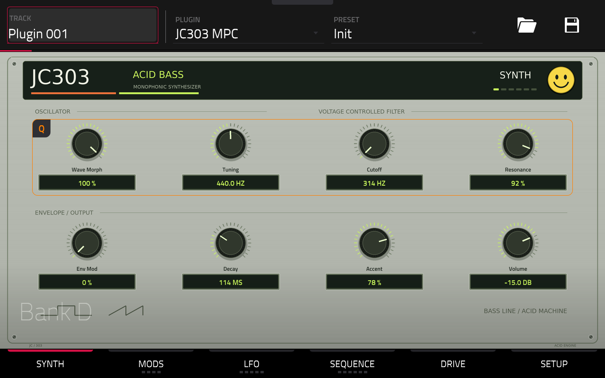 | 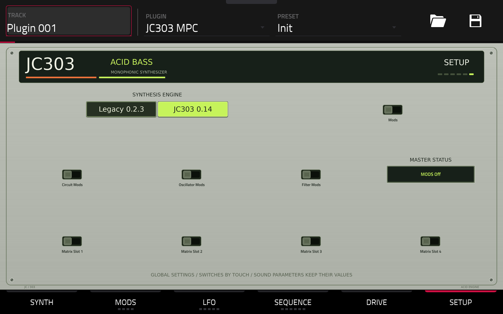 |

| MODS / CIRCUIT | MODS / OSC |
|---|---|
| 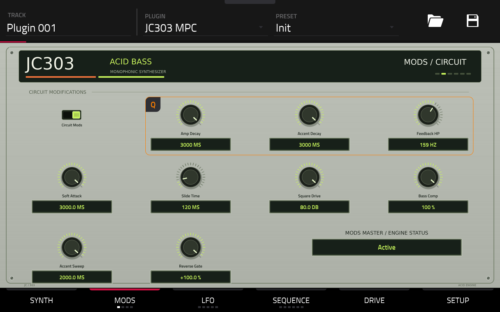 | 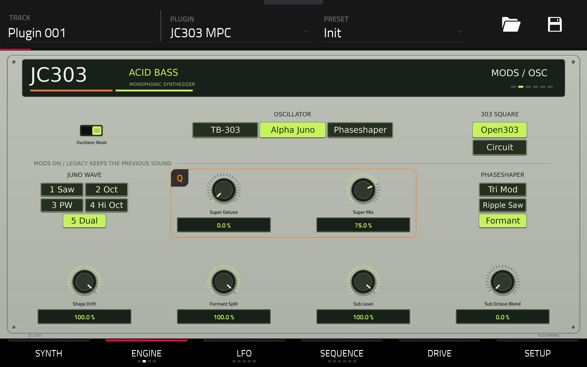 |

| MODS / FILTER | MODS / LEGACY |
|---|---|
| 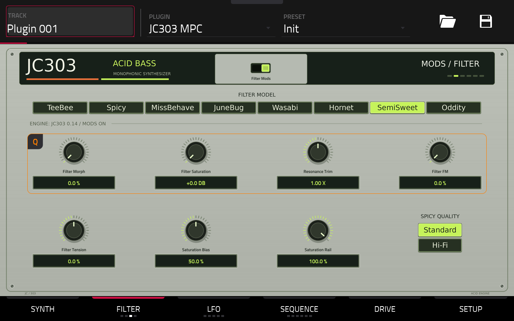 | 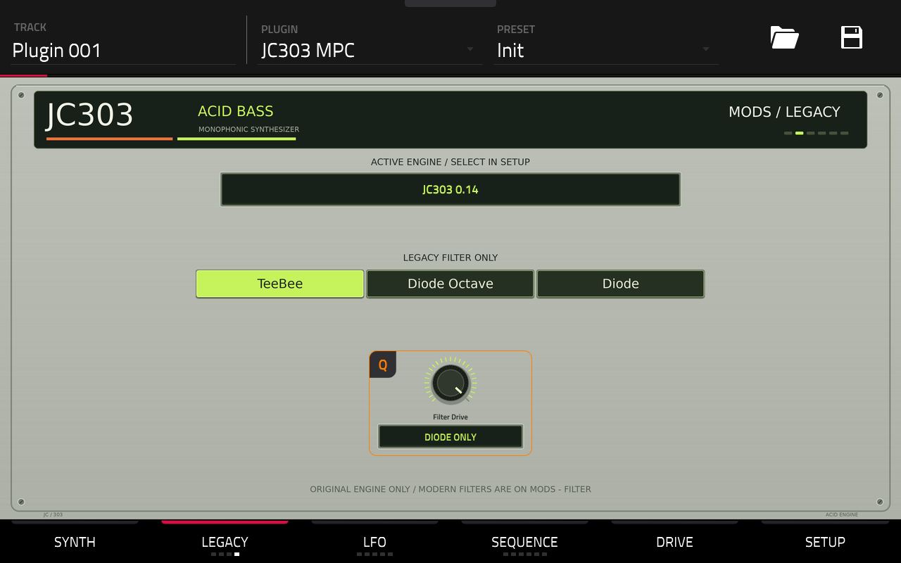 |

| LFO | MATRIX1 |
|---|---|
| 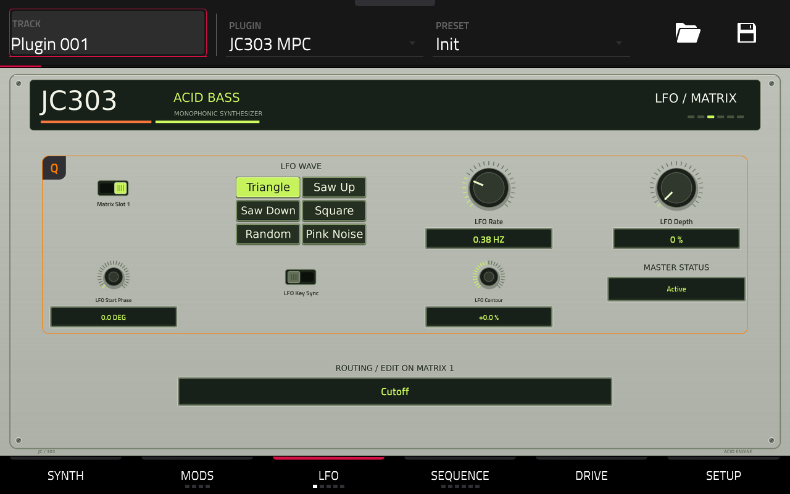 | 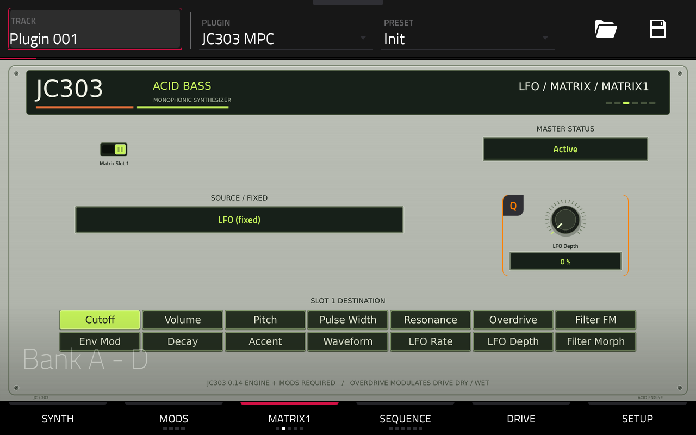 |

| MATRIX2 | MATRIX3 |
|---|---|
| 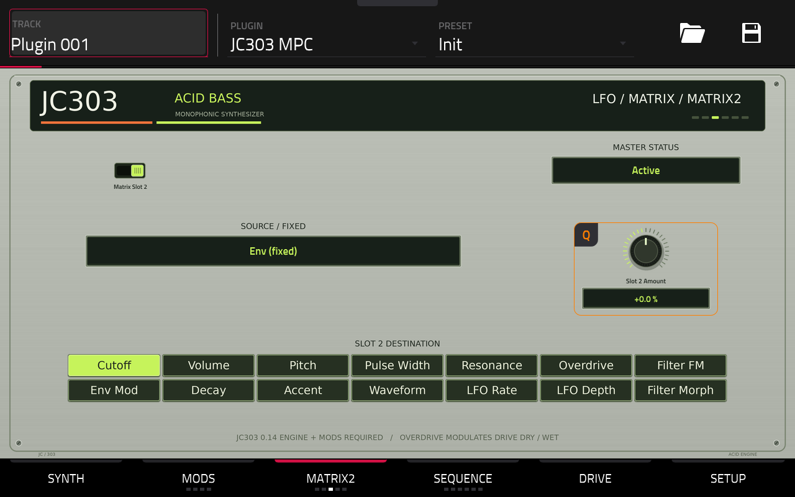 | 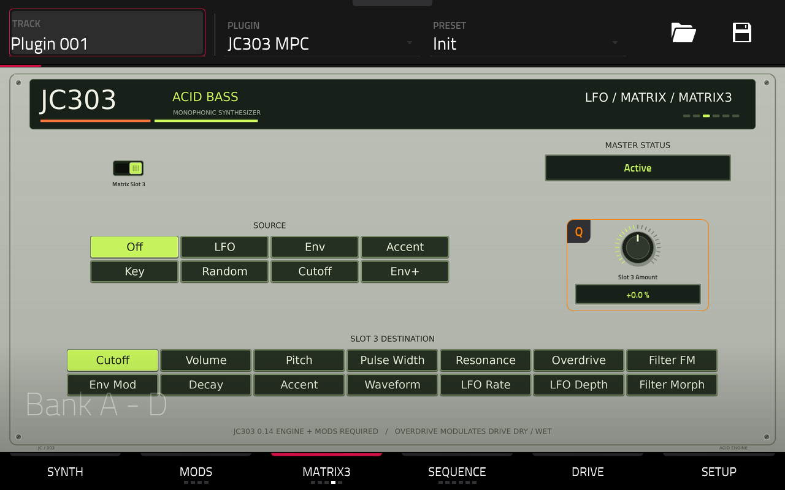 |

| MATRIX4 | SEQUENCE / piano roll |
|---|---|
|  | 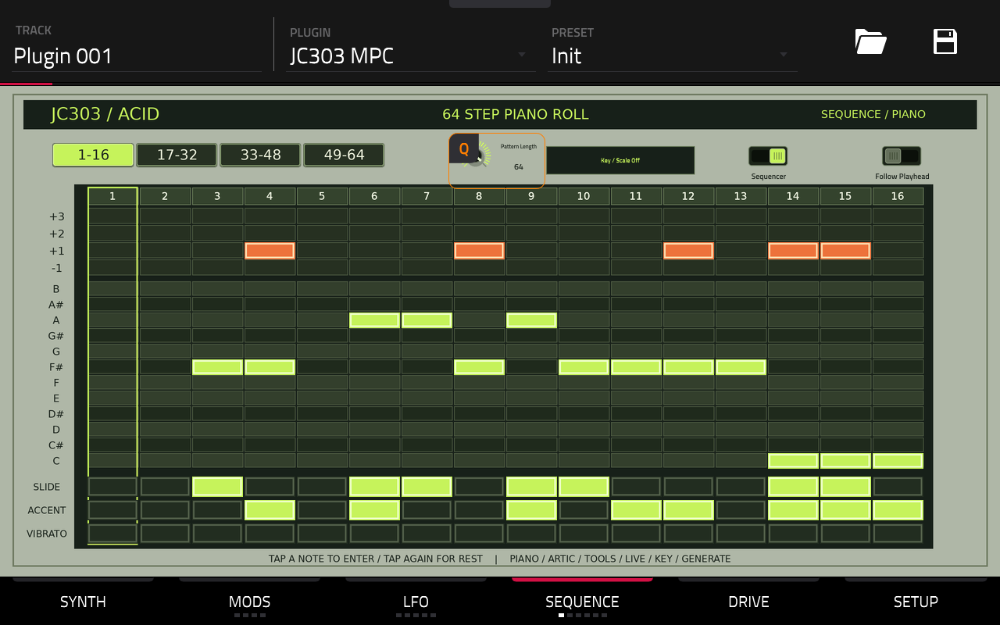 |

| SEQUENCE / ARTIC | SEQUENCE / TOOLS |
|---|---|
| 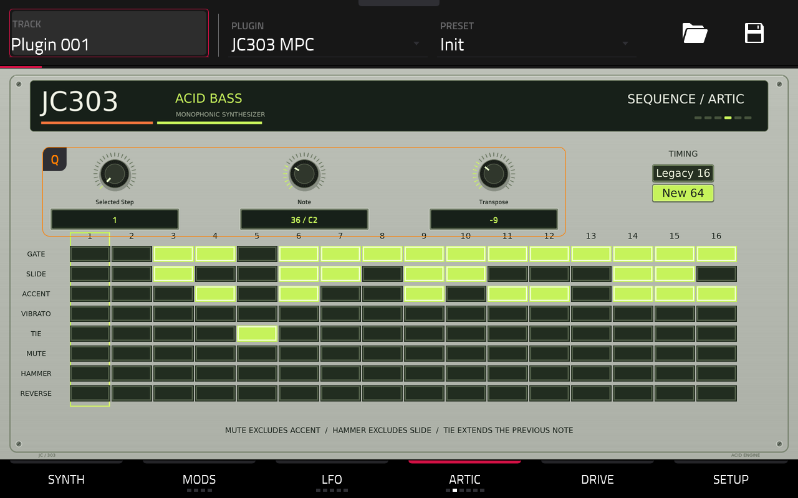 | 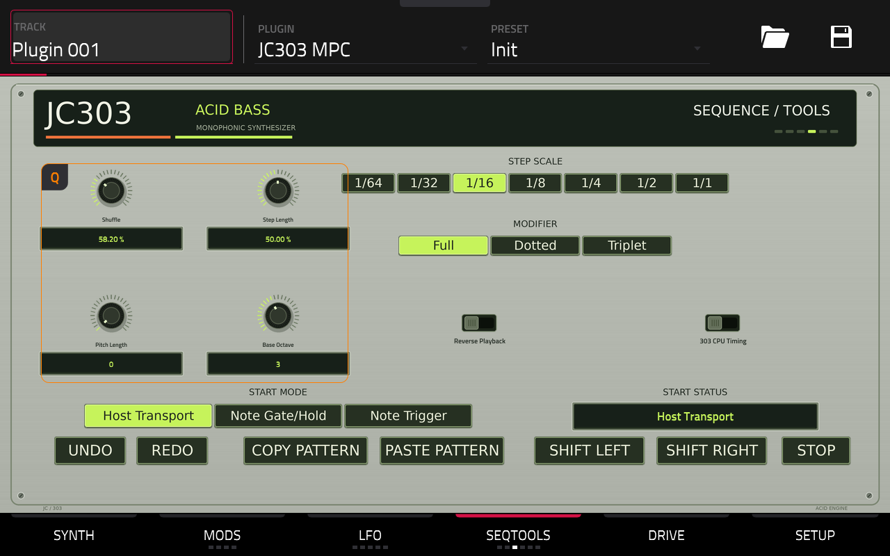 |

| SEQUENCE / LIVE | SEQUENCE / KEY |
|---|---|
| 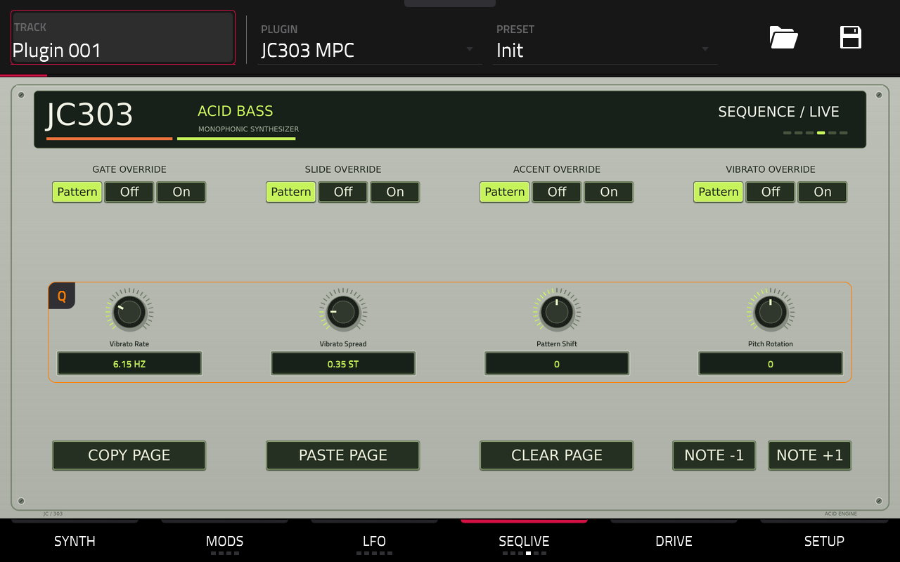 | 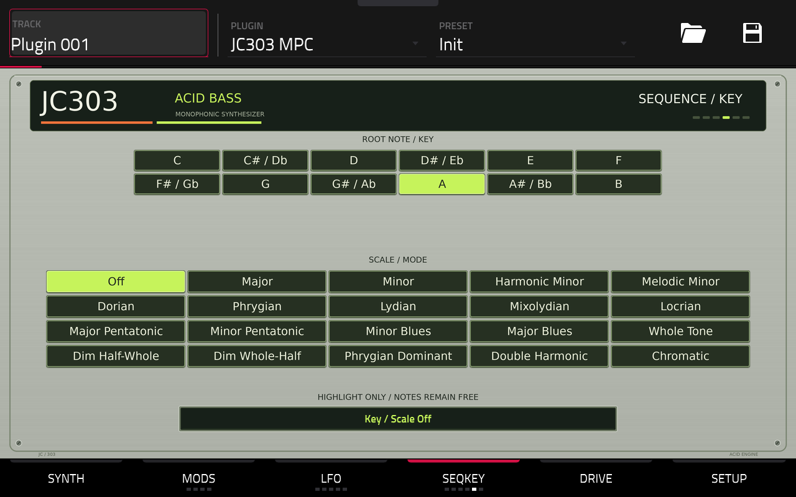 |

| SEQUENCE / GENERATE | DRIVE |
|---|---|
| 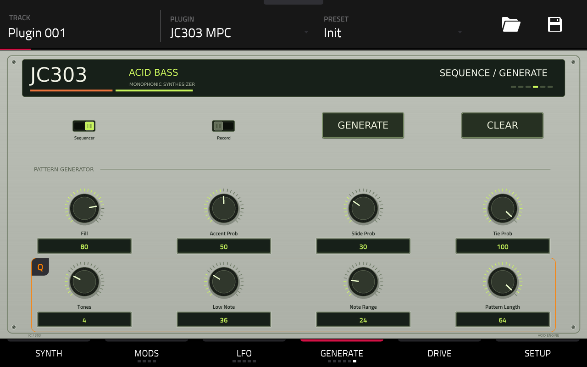 | 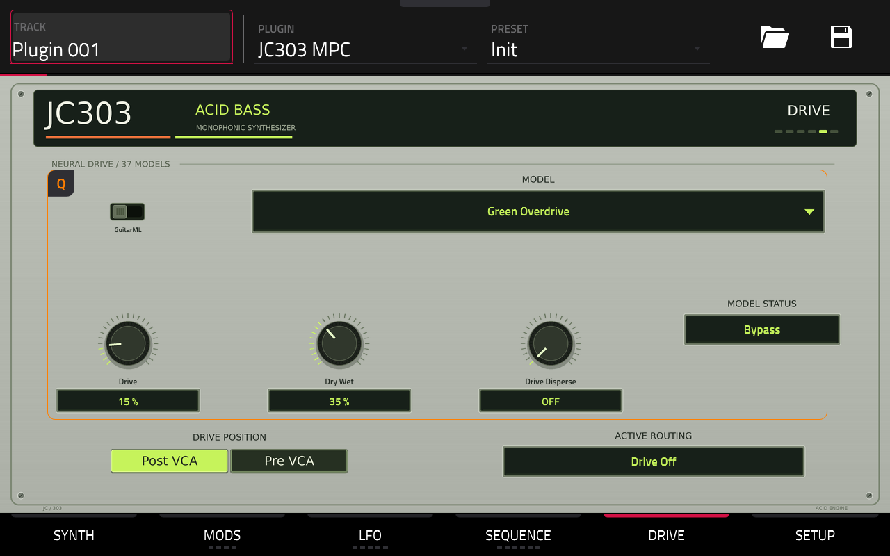 |

[Back to README](../README.md).
